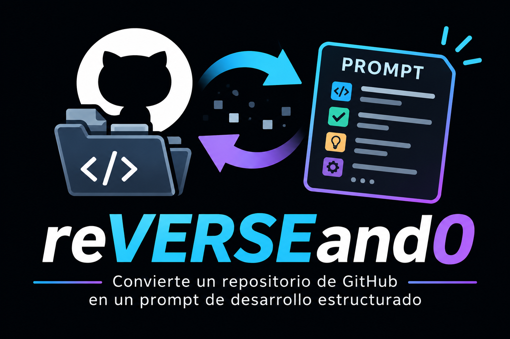

# reVERSEand0

<p align="center">



</p>

Genera un **prompt de desarrollo** en español a partir de:

- un **repositorio público de GitHub**, o
- una **página web** (tema visual y distribución).

Si configuras una API key de **Gemini**, el prompt lo genera el modelo (en modo web, con captura de pantalla); si no, o si Gemini está saturado, se usa una **plantilla PHP** local.


## Características

<p align="center">


</p>

- Modo **Repositorio**: metadatos públicos de GitHub (sin clonado ni OAuth)
- Modo **Página web**: HTML/CSS (+ captura local con Chrome/Chromium si hay Gemini)
- Generación con **Gemini** (opcional, multimodal en web) o **plantilla PHP** (fallback)
- Prompts siempre estructurados en **11 secciones** (objetivo, funcionalidades, arquitectura, tecnologías, directorios, datos, UI/UX, seguridad, requisitos, plan, criterios de aceptación)
- En modo web (y de forma general): distingue **hecho observado**, **inferencia** y **no verificable** para no inventar funcionalidades
- Failover automático entre modelos Gemini si hay saturación (503/429)
- Modo **manual**: título + descripción sin consultar GitHub ni la web
- Configuración de API key y modelo desde la interfaz
- Barra de progreso por etapas al generar el prompt
- Interruptor **claro / oscuro** (respeta el sistema y guarda la preferencia)
- Logos distintos por tema (`img/logo.png` / `img/logo-claro.png`)
- Documentación en modal (logo de cabecera) y enlace al repo en GitHub
- Copia del prompt al portapapeles
- Interfaz en español

## Requisitos

- **PHP 8.1+** (recomendado) con extensión **cURL**
- Servidor web (Apache, nginx) o el servidor integrado de PHP
- Conexión a Internet (GitHub, webs públicas, DNS-over-HTTPS y, si aplica, Gemini)
- Para capturas en modo web + Gemini: **Chrome o Chromium** instalado en la máquina
- Uso pensado para **entorno local**; la configuración de Gemini **no tiene autenticación**

## Instalación rápida

```bash
git clone https://github.com/entreunosyceros/reVERSEando.git
cd reVERSEando
```

Arranque con el servidor integrado de PHP:

```bash
php -S localhost:8080 -t .
```

Abre [http://localhost:8080](http://localhost:8080).

### Configuración de Gemini (opcional)

1. Obtén una API key en [Google AI Studio](https://aistudio.google.com/apikey).
2. En la app, pulsa **Configurar Gemini**.
3. Pega la key, elige el modelo (por defecto `gemini-3.5-flash-lite`) y guarda.

También puedes partir del ejemplo:

```bash
cp config/gemini.json.example config/gemini.json
```

Asegúrate de que el proceso de PHP pueda escribir en `config/`. El archivo `config/gemini.json` está en `.gitignore` y **no debe subirse** al repositorio.

## Uso

<p align="center">


</p>

1. Elige **Repositorio** o **Página web** (al cambiar de modo se limpia el prompt anterior).
2. Pega una URL (o un ejemplo). En repositorio también vale `propietario/repositorio`.
3. Pulsa **Obtener prompt**, espera la barra de progreso y copia el resultado.
4. Revisa la ficha **Calidad del análisis** y, si quieres, regenera solo algunas de las 11 secciones sin reanalizar el origen.

**Control manual:** título y descripción sin consultar GitHub ni la web.

El logo de la cabecera abre la documentación; al final del modal hay un enlace al repositorio en GitHub.

## Estructura del proyecto

```
reVERSEando/
├── index.php                 # UI principal
├── LICENSE                   # GNU GPL v3
├── README.md
├── api/
│   ├── generar_prompt.php
│   └── configuracion_gemini.php
├── lib/
│   ├── AnalizadorUrl.php
│   ├── ClienteGitHub.php
│   ├── ClienteWeb.php
│   ├── CapturadorPantalla.php
│   ├── ResolutorDns.php      # DNS-over-HTTPS (anti-fallo DNS local)
│   ├── ClienteGemini.php
│   ├── GeneradorPrompt.php
│   └── GestorConfiguracionGemini.php
├── assets/
│   ├── css/estilos.css
│   └── js/aplicacion.js
├── config/
│   └── gemini.json.example
├── img/
│   ├── logo.png              # tema oscuro
│   └── logo-claro.png        # tema claro
└── docs/superpowers/specs/   # notas de diseño (local; ver .gitignore)
```

## API (resumen)

### `POST /api/generar_prompt.php`

```json
{ "modo": "repositorio", "url": "https://github.com/propietario/repositorio" }
```

```json
{ "modo": "web", "url": "https://ejemplo.com" }
```

```json
{ "modo": "manual", "titulo": "Mi app", "descripcion": "..." }
```

```json
{
  "modo": "regenerar",
  "promptActual": "...",
  "secciones": ["2. Funcionalidades", "8. Seguridad"],
  "modoOrigen": "web",
  "contexto": { "modo": "web", "analisisWeb": { } }
}
```

Respuesta (campos relevantes):

```json
{
  "exito": true,
  "modo": "web",
  "fuente": "gemini",
  "prompt": "...",
  "calidadAnalisis": { "items": [{ "id": "html", "etiqueta": "HTML obtenido", "estado": "ok", "detalle": "..." }] },
  "contextoRegeneracion": { "modo": "web", "url": "...", "analisisWeb": { } },
  "secciones": ["1. Objetivo del proyecto", "..."],
  "aviso": "Gemini estaba saturado; se usó la plantilla local."
}
```

- `fuente`: `"gemini"` o `"plantilla"`
- `calidadAnalisis`: ficha OK / parcial / no / aviso del análisis
- `contextoRegeneracion`: contexto ligero para `modo=regenerar` (sin captura)
- `aviso`: opcional, si se hizo fallback a plantilla por saturación de Gemini

### `GET|POST /api/configuracion_gemini.php`

- `GET`: estado público (`configurado`, `sufijo_key`, `modelo`)
- `POST`: `{ "api_key": "...", "modelo": "gemini-3.5-flash-lite" }`  
  (API key vacía sin `limpiar_api_key` conserva la key actual; con limpieza se elimina)

## Seguridad

- Pensado para **uso local**. No publiques la app en Internet sin proteger la API key.
- No subas `config/gemini.json`.
- **Anti-SSRF (modo web):**
  - Solo `http`/`https` y puertos **80/443**
  - DNS-over-HTTPS + IP fijada en cURL (`CURLOPT_RESOLVE`); se verifica que la IP de conexión coincida (mitiga DNS rebinding)
  - Redirecciones seguidas a mano revalidando cada destino (máx. 3)
  - Bloqueo de IPs privadas/reservadas IPv4 e IPv6 (incl. link-local, ULA, multicast, IPv4-mapeadas)
  - Límites de tiempo/tamaño y filtro de `Content-Type` (HTML/CSS)
- **Chromium:** perfil temporal aislado, flags restrictivos y host fijado a IP pública validada
- **Prompt injection:** el contenido externo (README/HTML/CSS/texto) se envía a Gemini delimitado como datos de análisis, no como instrucciones; el system prompt prohíbe obedecer órdenes embebidas o revelar secretos
- Solo orígenes públicos; no elude login, captchas ni paywalls
- Respeta licencias y marcas de los sitios/repositorios analizados y las condiciones de GitHub y Google Gemini

## Limitaciones

- No analiza todo el código fuente ni SPAs que solo renderizan en el cliente.
- GitHub y Gemini tienen límites de tasa; Gemini puede devolver 503 (la app reintenta otros modelos o cae a plantilla).
- Sin Chromium, el modo web con Gemini no puede capturar la página (sigue el análisis HTML/CSS).
- Sitios con captcha o bloqueo a headless pueden fallar o dar resultados incompletos.

## Licencia

Este proyecto se distribuye bajo la **[GNU General Public License v3.0](LICENSE)** (GPL-3.0).

Eres libre de usar, estudiar, modificar y redistribuir el software siempre que respetes los términos de la GPL-3.0 (código derivado también bajo GPL-3.0, aviso de licencia, etc.).

```
reVERSEand0 — Copyright (C) 2026 entreunosyceros
This program comes with ABSOLUTELY NO WARRANTY.
This is free software, and you are welcome to redistribute it
under certain conditions; see LICENSE for details.
```
